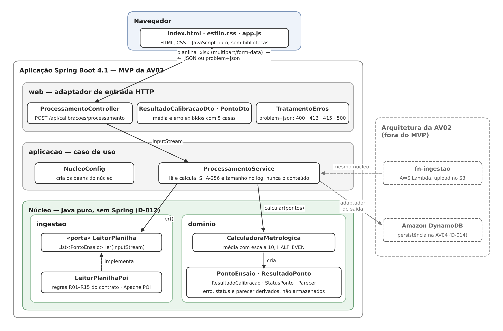
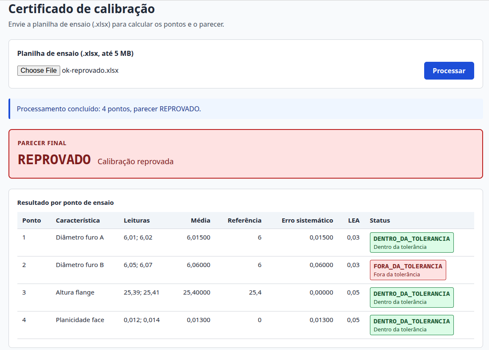
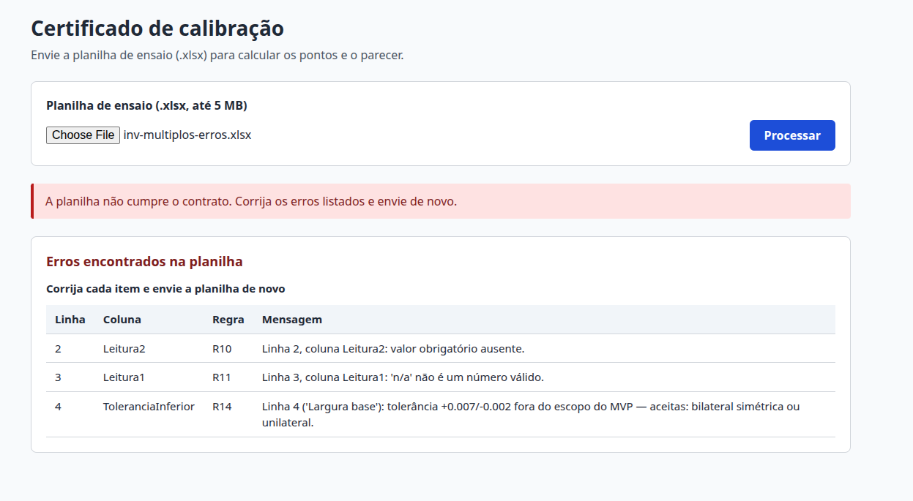

+------------------------+-----------------------------------------------------------------------------------------+
| **Unidade Curricular** | Projeto Aplicado III — UniSENAI/SC                                                      |
+------------------------+-----------------------------------------------------------------------------------------+
| **Docente**            | Prof. MSc. Hugo Menezes Barra                                                           |
+------------------------+-----------------------------------------------------------------------------------------+
| **Empresa parceira**   | Schulz S.A. — Schulz Metrologia (Setor Dimensional), Joinville/SC                       |
+------------------------+-----------------------------------------------------------------------------------------+
| **Autor**              | Rodrigo Mainardes Ribeiro                                                               |
+------------------------+-----------------------------------------------------------------------------------------+
| **Etapa**              | Construção da aplicação transacional do MVP                                             |
+------------------------+-----------------------------------------------------------------------------------------+
| **Entrega**            | AV3 — MVP, parte 1 — 15/10/2026                                                         |
+------------------------+-----------------------------------------------------------------------------------------+
| **Repositório**        | <https://github.com/rmainardes/projeto-aplicado-iii> (público)                          |
+------------------------+-----------------------------------------------------------------------------------------+
| **Stack**              | Java 17 · Spring Boot 4.1.1 · Apache POI 5.5.1 · HTML, CSS e JavaScript sem bibliotecas |
+------------------------+-----------------------------------------------------------------------------------------+

## Sumário

1.  **Introdução e vínculo com as entregas anteriores**
2.  **Arquitetura do MVP** — 2.1 Visão geral · 2.2 Fluxo de uma requisição · 2.3 Coerência com a arquitetura em nuvem da AV2 · 2.4 Stack e dependências
3.  **Ingestão da planilha (Item 1.1)** — 3.1 Do dado real ao contrato · 3.2 Contrato da planilha · 3.3 Regras de rejeição · 3.4 Decisão sobre o formato OOXML Strict
4.  **Regras de negócio e cálculos metrológicos (Item 1.2)** — 4.1 Fórmulas · 4.2 Fronteira e tipos de tolerância · 4.3 Precisão numérica · 4.4 Invariantes do domínio
5.  **Interface web**
6.  **Validação da entrada, segurança e LGPD**
7.  **Testes e evidências (Item 3)**
8.  **Rastreabilidade**
9.  **Limitações e próximos passos**
10. **Premissas, restrições e pontos a validar**
11. **Repositório e reprodução**
12. **Referências consultadas**

## Nota metodológica

Este relatório documenta o MVP construído para a AV3 e mantém as convenções das entregas anteriores. Cada decisão aponta para o item do roteiro e para o requisito (RF, RNF), a regra de negócio (RN), a anomalia (AN) ou o risco (RA) da AV1 que a justifica; a Seção 8 consolida essas ligações. O que não é evidência fica marcado: **\[PREMISSA\]** para suposição do autor, **\[VALIDAR\]** para pergunta em aberto à Schulz e **\[RESTRIÇÃO\]** para limite imposto ao projeto, todos reunidos na Seção 10.

Quatro famílias de identificadores aparecem no texto. **D-001 a D-014** são as decisões registradas em `docs/decisoes.md` (três dígitos, para não confundir com as dores D-01 a D-14 da AV1). **D-T04-1 a D-T04-5** são as decisões do mapeamento entre o vocabulário do roteiro e os dados reais. **R01 a R15** são as regras de rejeição do contrato da planilha. **CT-01 a CT-33** são os casos de teste da matriz de evidências.

**Mapa da entrega.** A tabela liga cada exigência do roteiro à seção que a trata e às evidências que a comprovam.

+-----------------------------------------------------------------------------------------------------------------------------------+-------------------------------------------------+-------------------------------------------------+
| Exigência do roteiro                                                                                                              | Seção                                           | Evidências                                      |
+===================================================================================================================================+=================================================+=================================================+
| Item 1.1 — ingestão do Excel com leituras e valores do padrão                                                                     | 3 e 6                                           | CT-08 a CT-27                                   |
+-----------------------------------------------------------------------------------------------------------------------------------+-------------------------------------------------+-------------------------------------------------+
| Item 1.2 — média, erro sistemático, |erro| × LEA, `DENTRO_DA_TOLERANCIA` / `FORA_DA_TOLERANCIA`, parecer `APROVADO` / `REPROVADO` | 4                                               | CT-01 a CT-07                                   |
+-----------------------------------------------------------------------------------------------------------------------------------+-------------------------------------------------+-------------------------------------------------+
| Objetivo da entrega — resultados e parecer numa interface limpa e intuitiva                                                       | 5                                               | CT-30 a CT-33                                   |
+-----------------------------------------------------------------------------------------------------------------------------------+-------------------------------------------------+-------------------------------------------------+
| Item 3 — evidências no relatório e repositório público com todo o código                                                          | 7 e 11                                          | CT-01 a CT-33                                   |
+-----------------------------------------------------------------------------------------------------------------------------------+-------------------------------------------------+-------------------------------------------------+
| Critério de avaliação — coerência da arquitetura transacional                                                                     | 2                                               | Seção 2.3                                       |
+-----------------------------------------------------------------------------------------------------------------------------------+-------------------------------------------------+-------------------------------------------------+

O roteiro passa do Item 1 para o Item 3. A ausência do Item 2 foi tratada como erro de numeração: a pergunta enviada ao docente em 10/10/2026 não teve resposta até a data deste relatório \[PREMISSA\]. A interface, pedida no objetivo da entrega, recebeu seção própria.

**Aplicação transacional, nesta entrega.** Cada requisição processa um arquivo de ponta a ponta: recebe, valida, calcula e responde. Não há estado intermediário. Uma planilha inválida não produz resultado parcial: a resposta traz todos os erros encontrados e nenhum cálculo. A gravação do resultado foi adiada para a AV4 (D-014), pelos motivos da Seção 2.3.

# 1. Introdução e vínculo com as entregas anteriores

A AV1 mostrou que a Schulz Metrologia leva 13 dias entre medir um dispositivo de controle na MMC e emitir o certificado (D-01), com 28 valores transportados à mão por certificado (D-02). Entre as dores críticas estavam a regra de aceitação com erro de sinal para tolerância negativa, que reprova falsamente todos os diâmetros (D-04, AN-17), o certificado sem declaração de conformidade (D-06, AN-34) e um cálculo em planilha não validado (RA-05).

A AV2 desenhou a arquitetura em nuvem: o operador envia a planilha sanitizada ao storage, o evento aciona a função `fn-ingestao`, que lê o arquivo, grava os dados e dispara a geração do certificado (DE-02). A AV2 deixou em aberto o layout exato da planilha, a fixar nesta entrega (PV-19).

Esta entrega constrói a primeira parte do MVP: a aplicação que recebe a planilha, valida a entrada, aplica as regras do roteiro e apresenta o resultado. Ela fecha a PV-19 com um contrato de planilha (Seção 3) e implementa um núcleo de cálculo que é o mesmo código que a `fn-ingestao` executará (Seção 2.3).

O roteiro simplifica o cálculo especificado na AV1: pede média, erro sistemático e comparação com o LEA, sem desvio padrão, incerteza, fator k nem graus de liberdade efetivos (RF-07, R-46 a R-50). O MVP implementa exatamente o que o roteiro pede; o restante está na Seção 9, com os códigos da AV1.

# 2. Arquitetura do MVP

## 2.1 Visão geral

A aplicação segue uma arquitetura de núcleo independente com adaptadores (hexagonal, em versão leve). O núcleo — leitura da planilha e cálculo — é Java puro e não importa nada do Spring (D-012). O Spring Boot fica nas pontas: recebe o arquivo por HTTP e devolve o resultado.

{width="6.5in"}

+------------------------------------+------------------------------------------------------+------------------------------------------------------------------------------------------------------------+------------------------------------+
| Pacote                             | Responsabilidade                                     | Classes principais                                                                                         | Usa Spring?                        |
+====================================+======================================================+============================================================================================================+====================================+
| `dominio`                          | Regras metrológicas: média, erro, status e parecer   | `CalculadoraMetrologica`, `PontoEnsaio`, `ResultadoPonto`, `ResultadoCalibracao`, `StatusPonto`, `Parecer` | Não                                |
+------------------------------------+------------------------------------------------------+------------------------------------------------------------------------------------------------------------+------------------------------------+
| `ingestao`                         | Leitura e validação da planilha (R01 a R15)          | Porta `LeitorPlanilha`, adaptador `LeitorPlanilhaPoi`, `ErroValidacao`, `PlanilhaInvalidaException`        | Não                                |
+------------------------------------+------------------------------------------------------+------------------------------------------------------------------------------------------------------------+------------------------------------+
| `aplicacao`                        | Caso de uso: ler e calcular; hash e tamanho no log   | `ProcessamentoService`, `NucleoConfig`                                                                     | Sim                                |
+------------------------------------+------------------------------------------------------+------------------------------------------------------------------------------------------------------------+------------------------------------+
| `web`                              | Adaptador HTTP: endpoint, DTOs e tratamento de erros | `ProcessamentoController`, `ResultadoCalibracaoDto`, `PontoDto`, `TratamentoErros`                         | Sim                                |
+------------------------------------+------------------------------------------------------+------------------------------------------------------------------------------------------------------------+------------------------------------+

As dependências apontam para dentro: `web` conhece `aplicacao`, que conhece a porta `LeitorPlanilha` e o `dominio`; o núcleo não conhece ninguém de fora. O Apache POI aparece só no adaptador `LeitorPlanilhaPoi`: a porta recebe um `InputStream` e devolve `List<PontoEnsaio>`, sem expor tipos do POI. Trocar a biblioteca, ou aceitar outro formato no futuro, não toca no cálculo. As classes do núcleo não levam anotações: a `NucleoConfig` cria os beans no pacote `aplicacao`.

## 2.2 Fluxo de uma requisição

1.  O navegador envia a planilha em `POST /api/calibracoes/processamento`, como `multipart/form-data`, no campo `arquivo`.
2.  O Spring recusa arquivos acima de 5 MB com 413, antes de qualquer leitura (Seção 6.1).
3.  O `ProcessamentoController` entrega o conteúdo como `InputStream` ao `ProcessamentoService`, que não conhece HTTP.
4.  O serviço envolve a entrada num medidor que calcula o SHA-256 e conta os bytes enquanto o leitor consome o arquivo, sem guardar uma segunda cópia.
5.  O `LeitorPlanilhaPoi` aplica as regras R01 a R15 e devolve os pontos de ensaio ou lança `PlanilhaInvalidaException` com a lista completa de erros.
6.  A `CalculadoraMetrologica` calcula a média de cada ponto e monta o `ResultadoCalibracao`; erro, status e parecer são derivados (Seção 4.4).
7.  O controller converte o resultado em DTO, com média e erro em 5 casas, e responde 200 em JSON — inclusive para `REPROVADO`, que é resultado, não erro.
8.  Qualquer exceção passa pelo `TratamentoErros` e sai como `application/problem+json` (RFC 9457).
9.  Ao final, com sucesso ou erro, o serviço registra no log o SHA-256 e o tamanho do arquivo, nunca o conteúdo nem o nome.

## 2.3 Coerência com a arquitetura em nuvem da AV2

O roteiro pede uma aplicação web; a AV2 desenhou um pipeline serverless. As duas coisas são compatíveis porque o meio do processo é o mesmo nos dois cenários e só as pontas mudam (D-012).

+----------------------+-----------------------------------------------+---------------------------------------------------------+
| Elemento             | MVP da AV3                                    | `fn-ingestao` (arquitetura da AV2)                      |
+======================+===============================================+=========================================================+
| Entrada              | Upload HTTP multipart                         | Evento de criação do objeto no S3                       |
+----------------------+-----------------------------------------------+---------------------------------------------------------+
| Adaptador de entrada | `ProcessamentoController`                     | Handler da Lambda, que abre o objeto como `InputStream` |
+----------------------+-----------------------------------------------+---------------------------------------------------------+
| Caso de uso          | `ProcessamentoService`                        | O mesmo                                                 |
+----------------------+-----------------------------------------------+---------------------------------------------------------+
| Leitura e validação  | `LeitorPlanilhaPoi` (R01 a R15)               | O mesmo                                                 |
+----------------------+-----------------------------------------------+---------------------------------------------------------+
| Cálculo              | `CalculadoraMetrologica` e records do domínio | O mesmo                                                 |
+----------------------+-----------------------------------------------+---------------------------------------------------------+
| Limite de tamanho    | Multipart (413) e R01 no leitor               | R01 no leitor                                           |
+----------------------+-----------------------------------------------+---------------------------------------------------------+
| Saída                | DTO em JSON para o navegador                  | Gravação no DynamoDB e acionamento da `fn-certificado`  |
+----------------------+-----------------------------------------------+---------------------------------------------------------+

Duas escolhas existem por causa da nuvem. A R01 (5 MB) é verificada também no leitor, e não só no multipart, porque na Lambda não há multipart: o leitor é a segunda barreira. O hash é calculado no serviço, e não no controller, para que a função na nuvem tenha a mesma rastreabilidade sem código novo.

A persistência foi adiada para a AV4 (D-014). O roteiro da AV3 não pede gravação do resultado, e persistir agora exigiria um banco local que não é o da arquitetura. A D-007 escolheu o DynamoDB, em que a unicidade é garantida pela aplicação, com itens-sentinela, e não por uma restrição `UNIQUE`. A idempotência por hash da AV1 (RN-20: nenhum arquivo é importado duas vezes) seria implementada duas vezes, com mecanismos diferentes. Na AV4, com o back-end pronto, a persistência entra direto no desenho da D-007. O hash já calculado na AV3 é a chave dessa idempotência.

## 2.4 Stack e dependências

+--------------------------+------------------+--------------------------------------------------------------------------------------+
| Componente               | Versão           | Observação                                                                           |
+==========================+==================+======================================================================================+
| Java                     | 17               | `java.version` 17 no `pom.xml`; compilado com o JDK Temurin 21                       |
+--------------------------+------------------+--------------------------------------------------------------------------------------+
| Spring Boot              | 4.1.1            | Starters `webmvc`, `validation` e `webmvc-test` (testes)                             |
+--------------------------+------------------+--------------------------------------------------------------------------------------+
| Apache POI (`poi-ooxml`) | 5.5.1            | **Única biblioteca externa** fora do ecossistema Spring, necessária para ler `.xlsx` |
+--------------------------+------------------+--------------------------------------------------------------------------------------+
| Maven                    | Wrapper (`mvnw`) | Dispensa instalar o Maven                                                            |
+--------------------------+------------------+--------------------------------------------------------------------------------------+
| Interface                | —                | HTML, CSS e JavaScript puro, sem bibliotecas                                         |
+--------------------------+------------------+--------------------------------------------------------------------------------------+

A escolha de Java (D-011) se deve à familiaridade do autor com a stack e ao `BigDecimal` nativo, que dá controle total sobre precisão e arredondamento; em Node, decimais exatos exigiriam biblioteca adicional. O projeto começou especificado em Spring Boot 3 e foi montado em 4.1, porque a linha 3.x saiu do suporte gratuito em 30/06/2026 (emenda da D-011).

A API responde com DTOs, e não com os records do domínio. Serializar o domínio direto exporia por padrão qualquer campo novo — um nome de técnico acrescentado no futuro, por exemplo (LGPD) — e mudaria o contrato da API sem aviso, quebrando a tela em silêncio.

# 3. Ingestão da planilha (Item 1.1)

## 3.1 Do dado real ao contrato

O roteiro usa o vocabulário genérico de calibração de instrumento; a Schulz calibra dispositivos de controle medidos na MMC. O primeiro passo foi mapear cada termo do roteiro para o dado real, no arquivo `Registro MMC (4).xlsx`, aba Report:

+----------------------------+-----------------------------------------------------------------+-----------------------------+
| Termo do roteiro           | Na Schulz                                                       | Onde está                   |
+============================+=================================================================+=============================+
| Ponto de ensaio            | Característica (Characteristic)                                 | Coluna A                    |
+----------------------------+-----------------------------------------------------------------+-----------------------------+
| Leituras                   | Valor medido (Actual), duas por ponto, em dois blocos de linhas | B14:B27 (1ª) e B29:B42 (2ª) |
+----------------------------+-----------------------------------------------------------------+-----------------------------+
| Valor padrão de referência | Nominal                                                         | Coluna C                    |
+----------------------------+-----------------------------------------------------------------+-----------------------------+
| LEA                        | Tolerância superior (Upper Tol)                                 | Coluna D                    |
+----------------------------+-----------------------------------------------------------------+-----------------------------+

O contrato adota o formato largo: uma linha por ponto, com colunas `Leitura1`, `Leitura2` e assim por diante. Isso elimina a separação posicional dos dois blocos de medição, que a AV1 apontou como anomalia (AN-04), e aceita qualquer número de leituras sem mudar o layout. As tolerâncias entram como superior e inferior, e o LEA é derivado: só assim o sistema consegue validar o tipo de tolerância (Seção 4.2).

## 3.2 Contrato da planilha

O contrato completo está em `docs/av03/contrato-planilha.md`. Em resumo:

+--------------------------------------------------------------------------+--------------------------------------------------------------------------------------------------------------------------------------------------------------------+
| Item                                                                     | Definição                                                                                                                                                          |
+==========================================================================+====================================================================================================================================================================+
| Formato                                                                  | `.xlsx` Transitional (“Pasta de Trabalho do Excel”); Strict rejeitado (Seção 3.4)                                                                                  |
+--------------------------------------------------------------------------+--------------------------------------------------------------------------------------------------------------------------------------------------------------------+
| Aba                                                                      | `Medicoes`; outras abas são ignoradas                                                                                                                              |
+--------------------------------------------------------------------------+--------------------------------------------------------------------------------------------------------------------------------------------------------------------+
| `Caracteristica`                                                         | Texto, obrigatório, único na planilha                                                                                                                              |
+--------------------------------------------------------------------------+--------------------------------------------------------------------------------------------------------------------------------------------------------------------+
| `ValorReferencia`                                                        | Número, em mm, obrigatório                                                                                                                                         |
+--------------------------------------------------------------------------+--------------------------------------------------------------------------------------------------------------------------------------------------------------------+
| `Leitura1`, `Leitura2`…                                                  | Número, em mm; pelo menos duas colunas, todas preenchidas em todas as linhas                                                                                       |
+--------------------------------------------------------------------------+--------------------------------------------------------------------------------------------------------------------------------------------------------------------+
| `ToleranciaSuperior`                                                     | Número, em mm, maior que zero; é o LEA                                                                                                                             |
+--------------------------------------------------------------------------+--------------------------------------------------------------------------------------------------------------------------------------------------------------------+
| `ToleranciaInferior`                                                     | Número, em mm: igual a −Tol+ (bilateral simétrica) ou zero (unilateral)                                                                                            |
+--------------------------------------------------------------------------+--------------------------------------------------------------------------------------------------------------------------------------------------------------------+
| Células numéricas                                                        | Do tipo Número. Texto que parece número (`"10,03"`) é rejeitado sem conversão, porque o separador decimal seria ambíguo; fórmulas também, mesmo com valor em cache |
+--------------------------------------------------------------------------+--------------------------------------------------------------------------------------------------------------------------------------------------------------------+
| Coluna `Desvio`                                                          | Rejeitada: valor calculado não entra (RN-28)                                                                                                                       |
+--------------------------------------------------------------------------+--------------------------------------------------------------------------------------------------------------------------------------------------------------------+

As colunas são localizadas pelo nome do cabeçalho, não pela posição. Os números são convertidos com `BigDecimal.valueOf(double)`, nunca com `new BigDecimal(double)`: o Excel grava 4,14 como `4.1399999999999997`, e só a primeira forma devolve `4.14`.

## 3.3 Regras de rejeição

As regras de arquivo e de estrutura interrompem a validação na hora, porque sem aba ou cabeçalho não há o que ler. As regras de linha são todas coletadas e devolvidas juntas, cada uma com linha, coluna, código da regra e mensagem — o operador corrige tudo de uma vez (CT-21).

+-------------------------------------------------+--------------------------------------------------------------------------------------------------------------------------------------------------------------------------------+-------------------------------------------------+
| Regra                                           | Verificação                                                                                                                                                                    | Tipo                                            |
+=================================================+================================================================================================================================================================================+=================================================+
| R01                                             | Arquivo maior que 5 MB                                                                                                                                                         | Arquivo                                         |
+-------------------------------------------------+--------------------------------------------------------------------------------------------------------------------------------------------------------------------------------+-------------------------------------------------+
| R02                                             | Conteúdo não é `.xlsx`, verificado pela assinatura do arquivo (*magic number*) e não pela extensão; inclui arquivo vazio, corrompido e zip com entrada acima do limite (D-013) | Arquivo                                         |
+-------------------------------------------------+--------------------------------------------------------------------------------------------------------------------------------------------------------------------------------+-------------------------------------------------+
| R03                                             | Formato OOXML Strict                                                                                                                                                           | Arquivo                                         |
+-------------------------------------------------+--------------------------------------------------------------------------------------------------------------------------------------------------------------------------------+-------------------------------------------------+
| R04                                             | Aba `Medicoes` ausente                                                                                                                                                         | Estrutura                                       |
+-------------------------------------------------+--------------------------------------------------------------------------------------------------------------------------------------------------------------------------------+-------------------------------------------------+
| R05                                             | Cabeçalho obrigatório ausente                                                                                                                                                  | Estrutura                                       |
+-------------------------------------------------+--------------------------------------------------------------------------------------------------------------------------------------------------------------------------------+-------------------------------------------------+
| R06                                             | Menos de duas colunas `Leitura*`                                                                                                                                               | Estrutura                                       |
+-------------------------------------------------+--------------------------------------------------------------------------------------------------------------------------------------------------------------------------------+-------------------------------------------------+
| R07                                             | Coluna `Desvio` presente                                                                                                                                                       | Estrutura                                       |
+-------------------------------------------------+--------------------------------------------------------------------------------------------------------------------------------------------------------------------------------+-------------------------------------------------+
| R08                                             | Nenhuma linha de dados                                                                                                                                                         | Estrutura                                       |
+-------------------------------------------------+--------------------------------------------------------------------------------------------------------------------------------------------------------------------------------+-------------------------------------------------+
| R09                                             | Mais de 10 mil linhas de dados                                                                                                                                                 | Estrutura                                       |
+-------------------------------------------------+--------------------------------------------------------------------------------------------------------------------------------------------------------------------------------+-------------------------------------------------+
| R10                                             | Valor obrigatório ausente                                                                                                                                                      | Linha                                           |
+-------------------------------------------------+--------------------------------------------------------------------------------------------------------------------------------------------------------------------------------+-------------------------------------------------+
| R11                                             | Valor não numérico (texto, booleano, erro ou fórmula)                                                                                                                          | Linha                                           |
+-------------------------------------------------+--------------------------------------------------------------------------------------------------------------------------------------------------------------------------------+-------------------------------------------------+
| R12                                             | Característica repetida                                                                                                                                                        | Linha                                           |
+-------------------------------------------------+--------------------------------------------------------------------------------------------------------------------------------------------------------------------------------+-------------------------------------------------+
| R13                                             | Tolerância superior zero ou negativa                                                                                                                                           | Linha                                           |
+-------------------------------------------------+--------------------------------------------------------------------------------------------------------------------------------------------------------------------------------+-------------------------------------------------+
| R14                                             | Tolerância fora dos dois tipos aceitos (assimétrica)                                                                                                                           | Linha                                           |
+-------------------------------------------------+--------------------------------------------------------------------------------------------------------------------------------------------------------------------------------+-------------------------------------------------+
| R15                                             | Leitura negativa em característica unilateral                                                                                                                                  | Linha                                           |
+-------------------------------------------------+--------------------------------------------------------------------------------------------------------------------------------------------------------------------------------+-------------------------------------------------+

As regras de R02 a R15, exceto a R09, têm uma planilha sintética própria (`inv-R02` a `inv-R15`), e todas as regras têm testes com o código da regra no nome. A R01 e a R09 são verificadas com arquivos gerados dentro dos próprios testes, porque não faz sentido versionar arquivos de 5 MB ou de 10 mil linhas.

## 3.4 Decisão sobre o formato OOXML Strict

A AV1 pedia a leitura de arquivos OOXML Strict (RF-01, RNF-13), porque a planilha real da Schulz está nesse formato. O teste de risco feito antes de qualquer outra parte do leitor mostrou que o Apache POI 5.5.1 recusa esse formato: o `XSSFWorkbook` lança `POIXMLException: Strict OOXML isn't currently supported`, tanto com o arquivo real (mantido fora do Git) quanto com a planilha sintética `inv-R03-strict.xlsx` (`PoiStrictTest`).

A decisão foi exigir o formato Transitional no contrato e detectar o Strict explicitamente (R03), com a mensagem “O arquivo está em formato OOXML Strict. Salve como ‘Pasta de Trabalho do Excel (.xlsx)’.” em vez de um erro genérico. A detecção usa `OPCPackage.isStrictOoxmlFormat()` e não o texto da exceção, que pode mudar entre versões. A decisão é sustentável porque a entrada do sistema é a planilha sanitizada pelo operador (DE-01), e salvar como Transitional é um passo dentro desse preparo. É uma divergência declarada em relação ao RNF-13, a confirmar com a Schulz \[VALIDAR PV-26\].

# 4. Regras de negócio e cálculos metrológicos (Item 1.2)

## 4.1 Fórmulas

+---------------------------+----------------------------------------------------------------+----------------------------------+------------------+
| Grandeza                  | Fórmula                                                        | Implementação                    | Requisito da AV1 |
+===========================+================================================================+==================================+==================+
| Média das leituras        | x̄ = Σ leituras / n                                             | `CalculadoraMetrologica.media`   | RN-03, RF-06     |
+---------------------------+----------------------------------------------------------------+----------------------------------+------------------+
| Erro sistemático          | E = x̄ − valor de referência (com sinal)                        | `ResultadoPonto.erroSistematico` | RF-06, RN-28     |
+---------------------------+----------------------------------------------------------------+----------------------------------+------------------+
| Limite de erro admissível | LEA = tolerância superior                                      | `PontoEnsaio.lea`                | RN-04, RN-05     |
+---------------------------+----------------------------------------------------------------+----------------------------------+------------------+
| Status do ponto           | |E| ≤ LEA → `DENTRO_DA_TOLERANCIA`; senão `FORA_DA_TOLERANCIA` | `ResultadoPonto.status`          | RF-08            |
+---------------------------+----------------------------------------------------------------+----------------------------------+------------------+
| Parecer final             | todos os pontos dentro → `APROVADO`; algum fora → `REPROVADO`  | `ResultadoCalibracao.parecer`    | RF-08, RN-08     |
+---------------------------+----------------------------------------------------------------+----------------------------------+------------------+

Os quatro valores dos enums aparecem literalmente no código, na API e na tela, como pede o roteiro.

## 4.2 Fronteira e tipos de tolerância

**Fronteira (D-T04-1).** Um ponto com |E| exatamente igual ao LEA está `DENTRO_DA_TOLERANCIA`: o limite faz parte da margem. O caso é testado nos dois sinais (`ok-limite.xlsx`, CT-03): E = +0,08 com LEA 0,08 e E = −0,05 com LEA 0,05.

**Tipos de tolerância (D-T04-2).** O MVP aceita a tolerância bilateral simétrica (Tol− = −Tol+) e a unilateral (Tol− = 0), usada em características geométricas como planicidade, paralelismo e posição. Nas duas, LEA = Tol+ e vale a mesma regra |E| ≤ LEA, sem ramificação. A tolerância assimétrica (+0,05 / −0,02, por exemplo) não cabe num LEA único e é rejeitada na ingestão (R14) como fora do escopo do MVP.

**Leitura negativa em característica unilateral (D-T04-3).** Uma medida geométrica não pode ser negativa. A planilha é rejeitada com linha e coluna (R15), em vez de virar um terceiro status, porque o roteiro só admite dois. Leitura igual a zero é aceita (CT-05).

**O erro de sinal da AV1.** A planilha atual da Schulz calcula o limite inferior subtraindo uma tolerância já negativa, e reprova falsamente todos os diâmetros (AN-17, D-04). A formulação |E| ≤ LEA elimina esse defeito por construção: não há subtração de tolerância com sinal.

## 4.3 Precisão numérica

Todo o cálculo usa `BigDecimal`. Em `double`, `0,1 + 0,2` resulta em `0,30000000000000004`, e um resíduo dessa ordem decide uma comparação de fronteira: nos dois pontos de `ok-limite.xlsx`, o cálculo em `double` classifica como fora uma peça que está exatamente no limite. As comparações usam `compareTo`, porque `equals` considera `2,0` e `2,00` diferentes.

**Escala da média.** A divisão usa 10 casas decimais com arredondamento `HALF_EVEN` (a regra do par da ABNT NBR 5891, sem viés). A escala 10 não altera nenhuma decisão. Com entradas de até d casas decimais e n leituras, |E| e LEA, quando diferentes, distam pelo menos 10⁻ᵈ/n, enquanto o arredondamento da média introduz no máximo 0,5 × 10⁻¹⁰. Com d = 7 (a resolução do dado bruto da MMC, AN-29), a decisão se mantém para menos de 2 000 leituras por ponto. E quando |E| = LEA, a média é um decimal finito com até d casas, e a divisão é exata \[PREMISSA PV-28\].

**Nunca arredondar antes de comparar (RN-18).** A média e o erro são guardados com precisão completa; o arredondamento para 5 casas acontece só na saída (DTO e tela). A planilha `ok-arredondamento.xlsx` prova a diferença: com E = 0,00045 e LEA 0,0004, arredondar a média para 4 casas antes de comparar aprovaria uma peça fora da tolerância (CT-06).

**A dízima.** Sem escala definida, a divisão de `BigDecimal` lança `ArithmeticException: Non-terminating decimal expansion` quando a média é uma dízima, como 10,02 / 3. O teste com três leituras foi escrito antes da implementação e falhou exatamente assim (achado A1); a planilha `ok-tres-leituras.xlsx` cobre o caso de ponta a ponta (CT-07).

## 4.4 Invariantes do domínio

**Valores derivados, não armazenados.** Erro sistemático, status e parecer não são campos dos records: são calculados a partir da média e do ponto. Assim não existe, por construção, um ponto com erro incoerente com a média, um ponto fora marcado como dentro, nem uma calibração com ponto fora e parecer `APROVADO`.

**Lista vazia.** Em Java, `allMatch` sobre uma lista vazia devolve `true`: uma implementação ingênua aprovaria uma calibração sem nenhum ponto. O `ResultadoCalibracao` rejeita a lista vazia no construtor, porque ausência de evidência não pode virar aprovação. O caso foi descoberto por mutação manual: com a verificação removida, todos os testes do cálculo continuaram verdes, e só um teste dedicado passou a pegar o defeito (achado A2).

+--------------------------------------+---------------------------------------------------------+
| Mutação introduzida                  | Testes que falharam                                     |
+======================================+=========================================================+
| `<= 0` trocado por `< 0` (fronteira) | Fronteiras positiva e negativa, `ok-limite`             |
+--------------------------------------+---------------------------------------------------------+
| `.abs()` removido                    | Erro negativo fora da tolerância, `ok-arredondamento`   |
+--------------------------------------+---------------------------------------------------------+
| `allMatch` trocado por `anyMatch`    | Um fora entre vários, mais três cenários da calculadora |
+--------------------------------------+---------------------------------------------------------+
| Verificação de lista vazia removida  | Só o teste dedicado `listaVazia`                        |
+--------------------------------------+---------------------------------------------------------+

**Defesa em profundidade.** O construtor do `PontoEnsaio` repete as regras de linha do contrato (R10, R13, R14, R15 e o mínimo de duas leituras). A ingestão rejeita antes, mas o domínio não aceita um ponto inválido vindo de outra origem, como a futura `fn-ingestao`.

# 5. Interface web

O objetivo da entrega pede os resultados e o parecer “numa interface de utilizador limpa e intuitiva”. A tela é uma página estática servida pelo próprio Spring Boot, em HTML, CSS e JavaScript puro, sem bibliotecas: o operador escolhe a planilha, envia e vê o parecer em destaque e uma tabela por ponto com leituras, média, referência, erro, LEA e status.

{width="6in"}

As escolhas da tela:

-   **Enum exato, rótulo e cor.** Status e parecer aparecem com o valor exato do roteiro, um rótulo em português e uma cor. A informação nunca depende só da cor (daltonismo; RNF-15 cita a WCAG 2.1 nível AA), e o contraste das cores é de pelo menos 4,5:1.
-   **Tabela semântica.** `<table>` com `<th scope="col">`, legível por leitores de tela.
-   **Texto inserido só com `textContent`.** A característica é texto livre vindo da planilha; inseri-la como HTML abriria espaço para injeção de script (XSS).
-   **CSS e JavaScript fora do HTML.** Permite, no futuro, uma política de segurança de conteúdo (CSP) com `script-src 'self'`.
-   **Tela sempre coerente.** O resultado anterior é limpo antes de cada envio, em caso de erro e ao trocar de arquivo; durante o envio, o botão e o campo de arquivo ficam travados. Sem a trava, a resposta de uma planilha apareceria sob o nome da seguinte (achado A12; CT-33).
-   **Formatação.** Média e erro com 5 casas e vírgula decimal; leituras, referência e LEA com as casas que o número trouxe, sem completar zeros.
-   **Erros legíveis.** A mensagem geral e uma tabela com linha, coluna, regra e mensagem de cada erro; no erro 500, o identificador para o suporte.

{width="6in"}

# 6. Validação da entrada, segurança e LGPD

O sistema é de apoio a um processo de metrologia sujeito à ISO/IEC 17025. A entrada é tratada como não confiável, os erros não expõem detalhes internos, e nenhum dado pessoal ou de cliente entra no log, no repositório ou nos testes.

## 6.1 Limites da entrada

+-------------------------+------------------------------------------------+----------------------------------------------------------+-----------+
| Limite                  | Onde                                           | Valor                                                    | Evidência |
+=========================+================================================+==========================================================+===========+
| Tamanho do upload       | Multipart do Spring                            | 5 MB (5 × 1024² bytes); acima disso, 413                 | CT-23     |
+-------------------------+------------------------------------------------+----------------------------------------------------------+-----------+
| Tamanho no leitor (R01) | `LeitorPlanilhaPoi`, antes de abrir o conteúdo | Os mesmos 5 MB; segunda barreira para a `fn-ingestao`    | CT-22     |
+-------------------------+------------------------------------------------+----------------------------------------------------------+-----------+
| Tipo do arquivo (R02)   | Assinatura do conteúdo, não a extensão         | Só OOXML; um CSV renomeado para `.xlsx` é recusado       | CT-08     |
+-------------------------+------------------------------------------------+----------------------------------------------------------+-----------+
| Bomba de descompactação | `ZipSecureFile` do POI (D-013)                 | 50 MB por entrada do zip                                 | CT-27     |
+-------------------------+------------------------------------------------+----------------------------------------------------------+-----------+
| Número de linhas (R09)  | Leitor                                         | 10 mil linhas de dados                                   | CT-26     |
+-------------------------+------------------------------------------------+----------------------------------------------------------+-----------+
| Fórmulas e macros       | Leitor                                         | Fórmulas rejeitadas (R11); nada é avaliado nem executado | CT-16     |
+-------------------------+------------------------------------------------+----------------------------------------------------------+-----------+

O limite do multipart e a R01 usam o mesmo byte: `5MB` no Spring vale 5 × 1024² bytes, igual à constante do leitor (achado A10). A fronteira foi provada com `curl`: um arquivo de exatamente 5 242 880 bytes passa da R01 e cai na R02, porque o conteúdo é aleatório; com 5 242 881 bytes, a resposta é 413 (CT-22 e CT-23). O teste automatizado com `MockMvc` não serve para isso, porque não aplica o limite do multipart (achado A7).

O `.xlsx` é um zip, e o POI carrega a aba inteira na memória. Os padrões do `ZipSecureFile` aceitam até 4 GB por entrada: mesmo com a R01, uma entrada muito comprimida chegaria a \~500 MB de XML. O leitor fixa 50 MB por entrada, mais de 10 vezes acima da maior planilha que o contrato aceita (10 mil linhas com 5 leituras geram \~4,2 MB de XML). Quem protege a memória são a R01 e a D-013; a R09 limita o volume de dados, não a memória (achado A4).

## 6.2 Tratamento de erros

Todos os erros saem no formato `application/problem+json` (RFC 9457), com mensagem em português:

+--------+----------------------------------+-------------------------------------------------------------------------------------+
| Código | Situação                         | Corpo                                                                               |
+========+==================================+=====================================================================================+
| 400    | Planilha fora do contrato        | Mensagem geral e a lista `erros`, com linha, coluna, regra e mensagem               |
+--------+----------------------------------+-------------------------------------------------------------------------------------+
| 400    | Requisição sem a parte `arquivo` | “Envie a planilha no campo ‘arquivo’ (multipart/form-data).”                        |
+--------+----------------------------------+-------------------------------------------------------------------------------------+
| 413    | Arquivo acima de 5 MB            | “O arquivo excede o limite de 5 MB.”                                                |
+--------+----------------------------------+-------------------------------------------------------------------------------------+
| 415    | Requisição que não é multipart   | Cabeçalho `Accept: multipart/form-data` e orientação de envio                       |
+--------+----------------------------------+-------------------------------------------------------------------------------------+
| 500    | Erro inesperado                  | Mensagem genérica e um `id`; o detalhe técnico fica só no log, ligado ao mesmo `id` |
+--------+----------------------------------+-------------------------------------------------------------------------------------+

O teste `ErroInesperadoTest` planta uma falha cuja mensagem contém o caminho `/srv/app/segredo/config.yml` e confirma que a resposta 500 não traz o caminho, o nome da exceção nem o rastro de pilha (CT-28). Durante a coleta de evidências, o 400 sem a parte `arquivo` saiu com a mensagem padrão do Spring, em inglês: a classe base do tratamento de erros só personaliza o que é sobrescrito explicitamente. O caso foi corrigido e ganhou um teste (achado A13; CT-25).

## 6.3 LGPD e rastreabilidade

-   **Log.** Cada planilha recebida deixa uma linha com o SHA-256 e o tamanho do arquivo — inclusive as inválidas —, nunca o conteúdo nem o nome do arquivo, que pode conter nome de cliente ou de técnico (RNF-07, RA-12). O hash identifica o arquivo para rastreabilidade (ISO/IEC 17025) sem expô-lo.
-   **Hash do arquivo inteiro.** Se o leitor parar antes do fim, o serviço consome o restante antes de registrar, para que o hash seja o do arquivo inteiro. Lacuna declarada: o 413 é recusado antes de chegar ao serviço e não gera linha de hash (achado A8).
-   **Dados de teste.** Todas as 21 planilhas versionadas são sintéticas, geradas por script, sem nome de autor nos metadados. Os arquivos reais da Schulz contêm dados de cliente e nome e matrícula de técnico (RA-11, RA-12) e ficam fora do Git, inclusive a planilha usada no teste de Strict.
-   **Repositório público.** Antes da publicação, o histórico completo do Git foi auditado: nenhum arquivo real da Schulz em nenhum commit, e o autor identificado apenas pelo e-mail anônimo do GitHub.
-   **Saída da API.** DTOs com campos explícitos impedem que um campo novo do domínio vaze por padrão (Seção 2.4).

# 7. Testes e evidências (Item 3)

## 7.1 Estratégia

Os valores esperados não vêm do código Java. Um script independente em Python, com aritmética decimal exata, gerou as 21 planilhas sintéticas e calculou o resultado esperado de cada uma — o **oráculo** (`docs/av03/oraculo-planilhas.md`). As 7 planilhas válidas cobrem um caso cada: aprovação, reprovação, fronteira, erro negativo, tolerância unilateral, arredondamento e média em dízima. As 14 inválidas violam uma regra cada, mais uma com três erros simultâneos.

O núcleo foi construído com testes escritos antes da implementação (TDD) e, onde a implementação já existia, validado por mutação manual (Seção 4.4). A API e a tela foram verificadas com as mesmas planilhas, por `curl` e no navegador. As 21 respostas da API foram conferidas contra o oráculo por um segundo script, também independente do Java: nenhuma divergência em parecer, status, média, erro, LEA ou regra, linha e coluna dos erros (achado A15).

## 7.2 Ambiente e linha de base

+------------------------+-----------------------------------------------------------+
| Item                   | Valor                                                     |
+========================+===========================================================+
| Commit                 | `86857e9`, sem alterações locais no código                |
+------------------------+-----------------------------------------------------------+
| Data da coleta         | 11/10/2026, 23:33 (UTC−3); prints da tela às 23:46–23:57  |
+------------------------+-----------------------------------------------------------+
| Sistema                | Ubuntu 24.04.4 LTS                                        |
+------------------------+-----------------------------------------------------------+
| JDK                    | Eclipse Temurin 21.0.10, compilando com `java.version` 17 |
+------------------------+-----------------------------------------------------------+
| Framework e biblioteca | Spring Boot 4.1.1 · Apache POI 5.5.1                      |
+------------------------+-----------------------------------------------------------+
| Cliente HTTP           | curl 8.5.0                                                |
+------------------------+-----------------------------------------------------------+
| Navegador              | Google Chrome 152 para Linux                              |
+------------------------+-----------------------------------------------------------+

Todas as respostas da API e a execução da suíte foram coletadas de uma vez, no mesmo commit. Uma evidência coletada antes de uma mudança no código não vale para o código novo; por isso o laço que gera as respostas está documentado em `docs/av03/evidencias.md` e recoletar custa segundos (achado A14). Os commits posteriores à linha de base alteram apenas a documentação.

## 7.3 Testes automatizados

+----------------------------------+--------+---------------------------------------------------------------------------------------------------------------------+
| Classe de teste                  | Testes | O que cobre                                                                                                         |
+==================================+========+=====================================================================================================================+
| `CalculadoraMetrologicaTest`     | 10     | Média (divisão exata, lista vazia e nula) e os 7 cenários válidos do oráculo, incluindo a dízima                    |
+----------------------------------+--------+---------------------------------------------------------------------------------------------------------------------+
| `ResultadoPontoTest`             | 8      | Dentro, fora, fronteira nos dois sinais, um passo acima da fronteira, erro negativo, arredondamento nos dois sinais |
+----------------------------------+--------+---------------------------------------------------------------------------------------------------------------------+
| `ResultadoCalibracaoTest`        | 3      | Parecer com todos dentro, um fora, lista vazia                                                                      |
+----------------------------------+--------+---------------------------------------------------------------------------------------------------------------------+
| `PoiStrictTest`                  | 2      | Recusa do formato Strict pelo POI (arquivo real e sintético)                                                        |
+----------------------------------+--------+---------------------------------------------------------------------------------------------------------------------+
| `LeitorPlanilhaPoiTest`          | 8      | Leitura campo a campo e as 7 planilhas válidas de ponta a ponta                                                     |
+----------------------------------+--------+---------------------------------------------------------------------------------------------------------------------+
| `LeitorPlanilhaPoiInvalidosTest` | 25     | Uma ou mais por regra, R01 a R15, com o código da regra no nome                                                     |
+----------------------------------+--------+---------------------------------------------------------------------------------------------------------------------+
| `ProcessamentoServiceTest`       | 3      | Hash e tamanho no log, inclusive em planilha inválida e acima da R01                                                |
+----------------------------------+--------+---------------------------------------------------------------------------------------------------------------------+
| `ProcessamentoControllerTest`    | 8      | Endpoint, JSON com 5 casas, 400 com todos os erros, 400 sem arquivo, 415                                            |
+----------------------------------+--------+---------------------------------------------------------------------------------------------------------------------+
| `ErroInesperadoTest`             | 1      | 500 com `id` e sem detalhe técnico                                                                                  |
+----------------------------------+--------+---------------------------------------------------------------------------------------------------------------------+
| `InterfaceWebTest`               | 2      | Página servida e encaminhamento da raiz para ela                                                                    |
+----------------------------------+--------+---------------------------------------------------------------------------------------------------------------------+
| `CertificadoApplicationTests`    | 1      | Contexto da aplicação sobe                                                                                          |
+----------------------------------+--------+---------------------------------------------------------------------------------------------------------------------+
| **Total**                        | **71** |                                                                                                                     |
+----------------------------------+--------+---------------------------------------------------------------------------------------------------------------------+

Na linha de base, a suíte executou 71 testes, sem falhas nem erros:

    [INFO] Tests run: 71, Failures: 0, Errors: 0, Skipped: 0
    [INFO] BUILD SUCCESS

Num clone limpo do repositório público, o resultado é `Tests run: 71, Failures: 0, Errors: 0, Skipped: 1`. O teste pulado usa a planilha real da Schulz, que não está no repositório; a mesma verificação roda com a planilha sintética.

## 7.4 Matriz de casos de teste

Todos os 33 casos passaram. O Obtido foi lido no arquivo de evidência correspondente, em `docs/av03/evidencias/`; a matriz completa, com Esperado e Obtido lado a lado, está em `docs/av03/evidencias.md`.

+-----------------------------+----------------------------------+----------------------------------------+------------------------------------------------------------------------------------------+-----------------------------+
| ID                          | Requisito                        | Entrada                                | Obtido                                                                                   | Resultado                   |
+=============================+==================================+========================================+==========================================================================================+=============================+
| CT-01                       | Item 1.2                         | `ok-aprovado.xlsx`                     | 200 · `APROVADO` · 3 pontos `DENTRO_DA_TOLERANCIA` · médias 4,13500 · 10,80900 · 0,92880 | Passou                      |
+-----------------------------+----------------------------------+----------------------------------------+------------------------------------------------------------------------------------------+-----------------------------+
| CT-02                       | Item 1.2 (parecer)               | `ok-reprovado.xlsx`                    | 200 · `REPROVADO` · só o Diâmetro furo B `FORA_DA_TOLERANCIA` (E = 0,06000 \> LEA 0,03)  | Passou                      |
+-----------------------------+----------------------------------+----------------------------------------+------------------------------------------------------------------------------------------+-----------------------------+
| CT-03                       | Item 1.2 · D-T04-1               | `ok-limite.xlsx`                       | 200 · `APROVADO` · E = 0,08000 e −0,05000, iguais ao LEA · `DENTRO_DA_TOLERANCIA`        | Passou                      |
+-----------------------------+----------------------------------+----------------------------------------+------------------------------------------------------------------------------------------+-----------------------------+
| CT-04                       | Item 1.2                         | `ok-erro-negativo.xlsx`                | 200 · `APROVADO` · E = −0,02500 e −0,01000 · `DENTRO_DA_TOLERANCIA`                      | Passou                      |
+-----------------------------+----------------------------------+----------------------------------------+------------------------------------------------------------------------------------------+-----------------------------+
| CT-05                       | Item 1.2 · D-T04-2 · R15         | `ok-unilateral.xlsx`                   | 200 · `REPROVADO` · Posição furo fora (0,12000 \> 0,1); leitura 0 aceita                 | Passou                      |
+-----------------------------+----------------------------------+----------------------------------------+------------------------------------------------------------------------------------------+-----------------------------+
| CT-06                       | Item 1.2 · RN-18                 | `ok-arredondamento.xlsx`               | 200 · `REPROVADO` · E = 0,00045 e −0,00045 \> LEA 0,0004 · `FORA_DA_TOLERANCIA`          | Passou                      |
+-----------------------------+----------------------------------+----------------------------------------+------------------------------------------------------------------------------------------+-----------------------------+
| CT-07                       | Item 1.1 (n leituras) · Item 1.2 | `ok-tres-leituras.xlsx`                | 200 · `REPROVADO` · médias 10,01667 e 1,00333 · Diâmetro haste fora                      | Passou                      |
+-----------------------------+----------------------------------+----------------------------------------+------------------------------------------------------------------------------------------+-----------------------------+
| CT-08                       | Item 1.1 · R02                   | `inv-R02-nao-xlsx.xlsx`                | 400 · R02                                                                                | Passou                      |
+-----------------------------+----------------------------------+----------------------------------------+------------------------------------------------------------------------------------------+-----------------------------+
| CT-09                       | Item 1.1 · R03                   | `inv-R03-strict.xlsx`                  | 400 · R03                                                                                | Passou                      |
+-----------------------------+----------------------------------+----------------------------------------+------------------------------------------------------------------------------------------+-----------------------------+
| CT-10                       | Item 1.1 · R04                   | `inv-R04-sem-aba.xlsx`                 | 400 · R04                                                                                | Passou                      |
+-----------------------------+----------------------------------+----------------------------------------+------------------------------------------------------------------------------------------+-----------------------------+
| CT-11                       | Item 1.1 · R05                   | `inv-R05-sem-tolsup.xlsx`              | 400 · R05 · coluna ToleranciaSuperior                                                    | Passou                      |
+-----------------------------+----------------------------------+----------------------------------------+------------------------------------------------------------------------------------------+-----------------------------+
| CT-12                       | Item 1.1 · R06                   | `inv-R06-uma-leitura.xlsx`             | 400 · R06                                                                                | Passou                      |
+-----------------------------+----------------------------------+----------------------------------------+------------------------------------------------------------------------------------------+-----------------------------+
| CT-13                       | Item 1.1 · R07 · D-T04-4         | `inv-R07-desvio.xlsx`                  | 400 · R07                                                                                | Passou                      |
+-----------------------------+----------------------------------+----------------------------------------+------------------------------------------------------------------------------------------+-----------------------------+
| CT-14                       | Item 1.1 · R08                   | `inv-R08-vazia.xlsx`                   | 400 · R08                                                                                | Passou                      |
+-----------------------------+----------------------------------+----------------------------------------+------------------------------------------------------------------------------------------+-----------------------------+
| CT-15                       | Item 1.1 · R10                   | `inv-R10-obrigatorio.xlsx`             | 400 · R10 · linha 3 · Leitura2                                                           | Passou                      |
+-----------------------------+----------------------------------+----------------------------------------+------------------------------------------------------------------------------------------+-----------------------------+
| CT-16                       | Item 1.1 · R11                   | `inv-R11-texto.xlsx`                   | 400 · R11 · linha 2 · Leitura1                                                           | Passou                      |
+-----------------------------+----------------------------------+----------------------------------------+------------------------------------------------------------------------------------------+-----------------------------+
| CT-17                       | Item 1.1 · R12                   | `inv-R12-repetida.xlsx`                | 400 · R12 · linha 5 · Caracteristica                                                     | Passou                      |
+-----------------------------+----------------------------------+----------------------------------------+------------------------------------------------------------------------------------------+-----------------------------+
| CT-18                       | Item 1.1 · R13                   | `inv-R13-tolsup-zero.xlsx`             | 400 · R13 · linha 4 · ToleranciaSuperior                                                 | Passou                      |
+-----------------------------+----------------------------------+----------------------------------------+------------------------------------------------------------------------------------------+-----------------------------+
| CT-19                       | Item 1.1 · R14 · D-T04-2         | `inv-R14-assimetrica.xlsx`             | 400 · R14 · linha 2 · ToleranciaInferior                                                 | Passou                      |
+-----------------------------+----------------------------------+----------------------------------------+------------------------------------------------------------------------------------------+-----------------------------+
| CT-20                       | Item 1.1 · R15 · D-T04-3         | `inv-R15-negativa-unilateral.xlsx`     | 400 · R15 · linha 5 · Leitura1                                                           | Passou                      |
+-----------------------------+----------------------------------+----------------------------------------+------------------------------------------------------------------------------------------+-----------------------------+
| CT-21                       | Item 1.1 · R10, R11, R14         | `inv-multiplos-erros.xlsx`             | 400 · três erros juntos: R10 (linha 2), R11 (linha 3), R14 (linha 4)                     | Passou                      |
+-----------------------------+----------------------------------+----------------------------------------+------------------------------------------------------------------------------------------+-----------------------------+
| CT-22                       | Item 1.1 · R01                   | Arquivo de 5 242 880 bytes             | 400 · R02: passou da R01                                                                 | Passou                      |
+-----------------------------+----------------------------------+----------------------------------------+------------------------------------------------------------------------------------------+-----------------------------+
| CT-23                       | Item 1.1 · R01                   | Arquivo de 5 242 881 bytes             | 413 · “O arquivo excede o limite de 5 MB.”                                               | Passou                      |
+-----------------------------+----------------------------------+----------------------------------------+------------------------------------------------------------------------------------------+-----------------------------+
| CT-24                       | Item 1.1 (upload)                | Corpo JSON                             | 415 · `Accept: multipart/form-data`                                                      | Passou                      |
+-----------------------------+----------------------------------+----------------------------------------+------------------------------------------------------------------------------------------+-----------------------------+
| CT-25                       | Item 1.1 (upload)                | Arquivo no campo errado                | 400 · mensagem em português pedindo o campo `arquivo`                                    | Passou                      |
+-----------------------------+----------------------------------+----------------------------------------+------------------------------------------------------------------------------------------+-----------------------------+
| CT-26                       | Item 1.1 · R09                   | Gerada no teste                        | 10 001 linhas → R09; 10 000 passam; linhas só formatadas não contam                      | Passou                      |
+-----------------------------+----------------------------------+----------------------------------------+------------------------------------------------------------------------------------------+-----------------------------+
| CT-27                       | R02 · D-013                      | —                                      | Limite do `ZipSecureFile` em 52 428 800 bytes (50 MB)                                    | Passou                      |
+-----------------------------+----------------------------------+----------------------------------------+------------------------------------------------------------------------------------------+-----------------------------+
| CT-28                       | Segurança e LGPD                 | Falha plantada com caminho do servidor | 500 · `id` · sem caminho, sem exceção, sem rastro de pilha                               | Passou                      |
+-----------------------------+----------------------------------+----------------------------------------+------------------------------------------------------------------------------------------+-----------------------------+
| CT-29                       | Evidências de teste              | Suíte completa                         | 71 testes · 0 falhas · 0 erros · BUILD SUCCESS                                           | Passou                      |
+-----------------------------+----------------------------------+----------------------------------------+------------------------------------------------------------------------------------------+-----------------------------+
| CT-30                       | Interface · Item 1.2 · RNF-15    | `ok-reprovado.xlsx` na tela            | Tabela com 4 pontos; status com enum, rótulo e cor; parecer `REPROVADO` em destaque      | Passou                      |
+-----------------------------+----------------------------------+----------------------------------------+------------------------------------------------------------------------------------------+-----------------------------+
| CT-31                       | Interface · Item 1.1             | `inv-multiplos-erros.xlsx` na tela     | Mensagem e tabela com os três erros (linha, coluna, regra, mensagem)                     | Passou                      |
+-----------------------------+----------------------------------+----------------------------------------+------------------------------------------------------------------------------------------+-----------------------------+
| CT-32                       | Interface · R01                  | Arquivo de 5 242 881 bytes na tela     | “O arquivo excede o limite de 5 MB.”, sem parecer nem tabela                             | Passou                      |
+-----------------------------+----------------------------------+----------------------------------------+------------------------------------------------------------------------------------------+-----------------------------+
| CT-33                       | Interface limpa                  | Troca de arquivo sem enviar            | Parecer, tabela e mensagens anteriores somem ao escolher o novo arquivo                  | Passou                      |
+-----------------------------+----------------------------------+----------------------------------------+------------------------------------------------------------------------------------------+-----------------------------+

## 7.5 Exemplos de evidência

Resposta da API para `ok-reprovado.xlsx` (CT-02; trecho com dois dos quatro pontos):

``` json
{
  "parecer": "REPROVADO",
  "pontos": [
    {
      "caracteristica": "Diâmetro furo A",
      "leituras": [6.01, 6.02],
      "valorReferencia": 6.0,
      "media": 6.01500,
      "erroSistematico": 0.01500,
      "lea": 0.03,
      "status": "DENTRO_DA_TOLERANCIA"
    },
    {
      "caracteristica": "Diâmetro furo B",
      "leituras": [6.05, 6.07],
      "valorReferencia": 6.0,
      "media": 6.06000,
      "erroSistematico": 0.06000,
      "lea": 0.03,
      "status": "FORA_DA_TOLERANCIA"
    }
  ]
}
```

Resposta para `inv-multiplos-erros.xlsx` (CT-21), com os três erros devolvidos juntos:

``` json
{
  "detail": "A planilha não cumpre o contrato. Corrija os erros listados e envie de novo.",
  "status": 400,
  "erros": [
    { "linha": 2, "coluna": "Leitura2", "regra": "R10",
      "mensagem": "Linha 2, coluna Leitura2: valor obrigatório ausente." },
    { "linha": 3, "coluna": "Leitura1", "regra": "R11",
      "mensagem": "Linha 3, coluna Leitura1: 'n/a' não é um número válido." },
    { "linha": 4, "coluna": "ToleranciaInferior", "regra": "R14",
      "mensagem": "Linha 4 ('Largura base'): tolerância +0.007/-0.002 fora do escopo do MVP — aceitas: bilateral simétrica ou unilateral." }
  ]
}
```

## 7.6 Achados do desenvolvimento

Os testes não serviram só para confirmar o que já se esperava. Os achados abaixo mudaram o código ou a forma de provar o comportamento:

+-------------------------------------------------+----------------------------------------------------------------------------------------------------------------------------+----------------------------------------------------------------------+
| Achado                                          | O que se observou                                                                                                          | Consequência                                                         |
+=================================================+============================================================================================================================+======================================================================+
| A1                                              | Sem escala, a divisão de `BigDecimal` lança `ArithmeticException` com média em dízima                                      | Escala 10 com `HALF_EVEN` (Seção 4.3)                                |
+-------------------------------------------------+----------------------------------------------------------------------------------------------------------------------------+----------------------------------------------------------------------+
| A2                                              | Com a verificação de lista vazia removida, toda a suíte do cálculo continuava verde                                        | Teste dedicado; calibração vazia rejeitada no construtor             |
+-------------------------------------------------+----------------------------------------------------------------------------------------------------------------------------+----------------------------------------------------------------------+
| A3                                              | O POI 5.5.1 recusa OOXML Strict                                                                                            | Regra R03 no contrato (Seção 3.4)                                    |
+-------------------------------------------------+----------------------------------------------------------------------------------------------------------------------------+----------------------------------------------------------------------+
| A4                                              | A R09 limita linhas, não memória                                                                                           | Memória protegida pela R01 e pela D-013                              |
+-------------------------------------------------+----------------------------------------------------------------------------------------------------------------------------+----------------------------------------------------------------------+
| A5                                              | O `jsonPath` dos testes compara números como `double`                                                                      | Só o texto cru da resposta prova a escala de 5 casas                 |
+-------------------------------------------------+----------------------------------------------------------------------------------------------------------------------------+----------------------------------------------------------------------+
| A6                                              | A referência `6` sai como `6.0` no JSON                                                                                    | A escala visível de leituras, referência e LEA não é contrato da API |
+-------------------------------------------------+----------------------------------------------------------------------------------------------------------------------------+----------------------------------------------------------------------+
| A7                                              | O `MockMvc` não aplica o limite do multipart                                                                               | 413 provado com `curl` (CT-22 e CT-23)                               |
+-------------------------------------------------+----------------------------------------------------------------------------------------------------------------------------+----------------------------------------------------------------------+
| A8                                              | O 413 é recusado antes do serviço                                                                                          | Lacuna declarada: sem linha de hash no log                           |
+-------------------------------------------------+----------------------------------------------------------------------------------------------------------------------------+----------------------------------------------------------------------+
| A9                                              | Um caminho do servidor na mensagem de uma exceção poderia vazar no 500                                                     | Teste prova que não vaza (CT-28)                                     |
+-------------------------------------------------+----------------------------------------------------------------------------------------------------------------------------+----------------------------------------------------------------------+
| A10                                             | `5MB` no Spring vale 5 × 1024² bytes                                                                                       | Mesmo byte no multipart e na R01                                     |
+-------------------------------------------------+----------------------------------------------------------------------------------------------------------------------------+----------------------------------------------------------------------+
| A11                                             | O `MockMvc` não segue o redirecionamento da página inicial                                                                 | Conteúdo provado em `/index.html`                                    |
+-------------------------------------------------+----------------------------------------------------------------------------------------------------------------------------+----------------------------------------------------------------------+
| A12                                             | Sem travar o campo durante o envio, a resposta anterior aparecia sob o nome do arquivo novo                                | Campo e botão travados; tela limpa na troca (CT-33)                  |
+-------------------------------------------------+----------------------------------------------------------------------------------------------------------------------------+----------------------------------------------------------------------+
| A13                                             | O 400 sem a parte `arquivo` saía com mensagem padrão em inglês                                                             | Mensagem sobrescrita e teste novo (CT-25)                            |
+-------------------------------------------------+----------------------------------------------------------------------------------------------------------------------------+----------------------------------------------------------------------+
| A14                                             | Evidência coletada antes de mudar o código não vale para o código novo                                                     | Linha de base única por commit; laço de coleta documentado           |
+-------------------------------------------------+----------------------------------------------------------------------------------------------------------------------------+----------------------------------------------------------------------+
| A15                                             | Conferência das 21 respostas por script independente                                                                       | Nenhuma divergência em relação ao oráculo                            |
+-------------------------------------------------+----------------------------------------------------------------------------------------------------------------------------+----------------------------------------------------------------------+
| A16                                             | Mensagens do leitor mostram números em formato invariante (`+0.007`) e um erro de montagem da tela cai na mensagem de rede | Limitações declaradas (Seção 9)                                      |
+-------------------------------------------------+----------------------------------------------------------------------------------------------------------------------------+----------------------------------------------------------------------+

# 8. Rastreabilidade

+----------------------------------------+-----------------------------+------------------------------------------------------------------+------------------------------------------------------------------------------------------+-----------------------------+
| Exigência                              | Requisitos da AV1           | Implementação                                                    | Testes automatizados                                                                     | Casos                       |
+========================================+=============================+==================================================================+==========================================================================================+=============================+
| Ingestão do Excel (Item 1.1)           | RF-01, RF-02, RN-02, UC-01  | `LeitorPlanilha`, `LeitorPlanilhaPoi`, `ProcessamentoController` | `LeitorPlanilhaPoiTest`, `LeitorPlanilhaPoiInvalidosTest`, `ProcessamentoControllerTest` | CT-07 a CT-27               |
+----------------------------------------+-----------------------------+------------------------------------------------------------------+------------------------------------------------------------------------------------------+-----------------------------+
| Média das leituras                     | RN-03, RF-06                | `CalculadoraMetrologica.media`                                   | `CalculadoraMetrologicaTest`                                                             | CT-01, CT-07                |
+----------------------------------------+-----------------------------+------------------------------------------------------------------+------------------------------------------------------------------------------------------+-----------------------------+
| Erro sistemático                       | RF-06, RN-28                | `ResultadoPonto.erroSistematico`                                 | `ResultadoPontoTest`                                                                     | CT-01 a CT-06               |
+----------------------------------------+-----------------------------+------------------------------------------------------------------+------------------------------------------------------------------------------------------+-----------------------------+
| |E| × LEA e status por ponto           | RF-08, RN-04, RN-05, AN-17  | `ResultadoPonto.status`, `PontoEnsaio.lea`                       | `ResultadoPontoTest`                                                                     | CT-03 a CT-06               |
+----------------------------------------+-----------------------------+------------------------------------------------------------------+------------------------------------------------------------------------------------------+-----------------------------+
| Parecer final                          | RF-08, RN-08, AN-34         | `ResultadoCalibracao.parecer`                                    | `ResultadoCalibracaoTest`                                                                | CT-01, CT-02                |
+----------------------------------------+-----------------------------+------------------------------------------------------------------+------------------------------------------------------------------------------------------+-----------------------------+
| Precisão e arredondamento              | RN-18, RA-05, AN-29         | `CalculadoraMetrologica` (escala 10), `PontoDto` (5 casas)       | `CalculadoraMetrologicaTest`, `ProcessamentoControllerTest`                              | CT-06, CT-07                |
+----------------------------------------+-----------------------------+------------------------------------------------------------------+------------------------------------------------------------------------------------------+-----------------------------+
| Número de leituras                     | RN-01, RN-02, AN-04         | R06 e R10 no leitor; `PontoEnsaio`                               | `LeitorPlanilhaPoiInvalidosTest`                                                         | CT-12, CT-15                |
+----------------------------------------+-----------------------------+------------------------------------------------------------------+------------------------------------------------------------------------------------------+-----------------------------+
| Desvio da origem não usado             | RN-28, AN-05                | R07 no leitor                                                    | `LeitorPlanilhaPoiInvalidosTest`                                                         | CT-13                       |
+----------------------------------------+-----------------------------+------------------------------------------------------------------+------------------------------------------------------------------------------------------+-----------------------------+
| Formato Strict (divergência declarada) | RF-01, RNF-13               | R03 no leitor                                                    | `PoiStrictTest`, `LeitorPlanilhaPoiInvalidosTest`                                        | CT-09                       |
+----------------------------------------+-----------------------------+------------------------------------------------------------------+------------------------------------------------------------------------------------------+-----------------------------+
| Interface (objetivo da entrega)        | RNF-15                      | `static/index.html`, `app.js`, `estilo.css`                      | `InterfaceWebTest`                                                                       | CT-30 a CT-33               |
+----------------------------------------+-----------------------------+------------------------------------------------------------------+------------------------------------------------------------------------------------------+-----------------------------+
| Erros sem detalhe interno              | RNF-07, RA-12               | `TratamentoErros`                                                | `ErroInesperadoTest`, `ProcessamentoControllerTest`                                      | CT-23 a CT-25, CT-28        |
+----------------------------------------+-----------------------------+------------------------------------------------------------------+------------------------------------------------------------------------------------------+-----------------------------+
| Hash do arquivo (base da idempotência) | RN-20 (parcial, D-014)      | `ProcessamentoService`                                           | `ProcessamentoServiceTest`                                                               | —                           |
+----------------------------------------+-----------------------------+------------------------------------------------------------------+------------------------------------------------------------------------------------------+-----------------------------+
| Dados pessoais fora do log e do Git    | RNF-07, RN-35, RA-11, RA-12 | `ProcessamentoService`, `.gitignore`, planilhas sintéticas       | `ProcessamentoServiceTest`                                                               | —                           |
+----------------------------------------+-----------------------------+------------------------------------------------------------------+------------------------------------------------------------------------------------------+-----------------------------+

# 9. Limitações e próximos passos

+---------------------------------------------------------------------------------------------------------------------+-----------------------------------------------+-------------------------------------------------------------------------------------------------------------------+------------------------------------+
| Limitação                                                                                                           | Motivo                                        | Próximo passo                                                                                                     | Referência                         |
+=====================================================================================================================+===============================================+===================================================================================================================+====================================+
| Sem persistência nem idempotência                                                                                   | Fora do roteiro da AV3; banco definido na AV2 | Gravação no DynamoDB com o hash como chave, na AV4                                                                | D-014, D-007, RN-20                |
+---------------------------------------------------------------------------------------------------------------------+-----------------------------------------------+-------------------------------------------------------------------------------------------------------------------+------------------------------------+
| Sem incerteza de medição (u, veff, k, U) nem zona de dúvida                                                         | Fora do roteiro da AV3                        | Orçamento de incerteza e status “não conclusivo”                                                                  | RF-07, RN-09, RN-10, R-46 a R-50   |
+---------------------------------------------------------------------------------------------------------------------+-----------------------------------------------+-------------------------------------------------------------------------------------------------------------------+------------------------------------+
| Sem geração do PDF do certificado                                                                                   | Fora do roteiro da AV3                        | Emissão (UC-03) com a `fn-certificado`                                                                            | RF-10, D-005                       |
+---------------------------------------------------------------------------------------------------------------------+-----------------------------------------------+-------------------------------------------------------------------------------------------------------------------+------------------------------------+
| Sem autenticação nem aprovação do signatário                                                                        | Fora do roteiro da AV3                        | Cognito e fluxo de aprovação da AV2                                                                               | RNF-05, RF-12, D-010               |
+---------------------------------------------------------------------------------------------------------------------+-----------------------------------------------+-------------------------------------------------------------------------------------------------------------------+------------------------------------+
| Formato Strict recusado                                                                                             | O POI 5.5.1 não lê Strict                     | Confirmar com a Schulz que a planilha sanitizada sai em Transitional                                              | RNF-13, PV-26                      |
+---------------------------------------------------------------------------------------------------------------------+-----------------------------------------------+-------------------------------------------------------------------------------------------------------------------+------------------------------------+
| Tolerância assimétrica recusada                                                                                     | Não cabe num LEA único                        | Estender a regra se a Schulz usar esse tipo                                                                       | D-T04-2, R14                       |
+---------------------------------------------------------------------------------------------------------------------+-----------------------------------------------+-------------------------------------------------------------------------------------------------------------------+------------------------------------+
| Núcleo ainda não implantado na nuvem                                                                                | Escopo da AV3 é a aplicação web               | Handler da `fn-ingestao` sobre o mesmo núcleo; avaliar leitura por streaming (SAX) para reduzir memória na Lambda | D-012, PV-22                       |
+---------------------------------------------------------------------------------------------------------------------+-----------------------------------------------+-------------------------------------------------------------------------------------------------------------------+------------------------------------+
| Desempenho e cobertura não medidos formalmente                                                                      | Fora do roteiro da AV3                        | Medir o tempo de processamento de 100 características e a cobertura do módulo de cálculo                          | RNF-01, RNF-08                     |
+---------------------------------------------------------------------------------------------------------------------+-----------------------------------------------+-------------------------------------------------------------------------------------------------------------------+------------------------------------+
| 413 sem linha de hash no log                                                                                        | O limite atua antes do serviço                | Registrar a recusa no filtro do multipart                                                                         | Achado A8                          |
+---------------------------------------------------------------------------------------------------------------------+-----------------------------------------------+-------------------------------------------------------------------------------------------------------------------+------------------------------------+
| Mensagens do leitor com número em formato invariante (`+0.007`); erro de montagem da tela exibido como erro de rede | Simplicidade do MVP                           | Formatar com vírgula e separar os dois casos                                                                      | Achado A16                         |
+---------------------------------------------------------------------------------------------------------------------+-----------------------------------------------+-------------------------------------------------------------------------------------------------------------------+------------------------------------+

# 10. Premissas, restrições e pontos a validar

+------------------------------------+------------------------------------+-----------------------------------------------------------------------------------------------------------------------------------------------------------------------------------------------------------------+---------------------------------------------------------------------------------------------------------------------------------------------------------------------------------+
| ID                                 | Tipo                               | Item                                                                                                                                                                                                            | Impacto se a premissa for falsa                                                                                                                                                 |
+====================================+====================================+=================================================================================================================================================================================================================+=================================================================================================================================================================================+
| PV-19                              | Respondido                         | Layout da planilha sanitizada, deixado em aberto pela AV2                                                                                                                                                       | Fixado pelo contrato da Seção 3                                                                                                                                                 |
+------------------------------------+------------------------------------+-----------------------------------------------------------------------------------------------------------------------------------------------------------------------------------------------------------------+---------------------------------------------------------------------------------------------------------------------------------------------------------------------------------+
| Item 2                             | \[PREMISSA\]                       | O roteiro não tem Item 2; tratado como erro de numeração (pergunta ao docente sem resposta)                                                                                                                     | Se houver requisitos próprios, entram na AV4                                                                                                                                    |
+------------------------------------+------------------------------------+-----------------------------------------------------------------------------------------------------------------------------------------------------------------------------------------------------------------+---------------------------------------------------------------------------------------------------------------------------------------------------------------------------------+
| PV-02                              | \[VALIDAR\]                        | As seis características de posição do certificado 00091/2026 medem entre 0,132 e 0,959 para LEA 0,100. Pela regra do roteiro, o resultado é `REPROVADO`, e o certificado atual as imprime sem parecer (D-T04-5) | Se a posição seguir outro critério, a regra precisa de tratamento próprio. Se seguir o mesmo, o sistema revela uma não conformidade que o certificado atual não declara (AN-34) |
+------------------------------------+------------------------------------+-----------------------------------------------------------------------------------------------------------------------------------------------------------------------------------------------------------------+---------------------------------------------------------------------------------------------------------------------------------------------------------------------------------+
| PV-24                              | \[VALIDAR\]                        | Mínimo de duas leituras por ponto: é exigência do procedimento da Schulz?                                                                                                                                       | Altera a R06 e o construtor do `PontoEnsaio` (RN-01)                                                                                                                            |
+------------------------------------+------------------------------------+-----------------------------------------------------------------------------------------------------------------------------------------------------------------------------------------------------------------+---------------------------------------------------------------------------------------------------------------------------------------------------------------------------------+
| PV-25                              | \[VALIDAR\]                        | A coluna Deviation da MMC diverge de Actual − Nominal em duas linhas (AN-05); o MVP recalcula sempre e recusa a coluna (D-T04-4)                                                                                | Nenhum no cálculo; a divergência na origem continua a esclarecer                                                                                                                |
+------------------------------------+------------------------------------+-----------------------------------------------------------------------------------------------------------------------------------------------------------------------------------------------------------------+---------------------------------------------------------------------------------------------------------------------------------------------------------------------------------+
| PV-26                              | \[VALIDAR\]                        | A planilha sanitizada pode ser salva como `.xlsx` Transitional                                                                                                                                                  | Se não puder, é preciso converter o Strict antes da leitura (RNF-13)                                                                                                            |
+------------------------------------+------------------------------------+-----------------------------------------------------------------------------------------------------------------------------------------------------------------------------------------------------------------+---------------------------------------------------------------------------------------------------------------------------------------------------------------------------------+
| PV-27                              | \[PREMISSA\]                       | As tolerâncias são bilaterais simétricas ou unilaterais                                                                                                                                                         | Tolerância assimétrica exige regra própria (R14)                                                                                                                                |
+------------------------------------+------------------------------------+-----------------------------------------------------------------------------------------------------------------------------------------------------------------------------------------------------------------+---------------------------------------------------------------------------------------------------------------------------------------------------------------------------------+
| PV-28                              | \[PREMISSA\]                       | Entradas com até 7 casas decimais e menos de 2 000 leituras por ponto                                                                                                                                           | Fora disso, a escala 10 da média precisaria ser revista (Seção 4.3)                                                                                                             |
+------------------------------------+------------------------------------+-----------------------------------------------------------------------------------------------------------------------------------------------------------------------------------------------------------------+---------------------------------------------------------------------------------------------------------------------------------------------------------------------------------+
| PV-29                              | \[PREMISSA\]                       | Todas as grandezas da planilha estão em milímetros                                                                                                                                                              | Outra unidade exigiria coluna de unidade no contrato (RN-27)                                                                                                                    |
+------------------------------------+------------------------------------+-----------------------------------------------------------------------------------------------------------------------------------------------------------------------------------------------------------------+---------------------------------------------------------------------------------------------------------------------------------------------------------------------------------+
| PV-22                              | \[PREMISSA\]                       | Tempos de execução das funções na nuvem, que a AV2 previa medir nesta entrega                                                                                                                                   | A função não foi implantada; a medição passa para a etapa de nuvem                                                                                                              |
+------------------------------------+------------------------------------+-----------------------------------------------------------------------------------------------------------------------------------------------------------------------------------------------------------------+---------------------------------------------------------------------------------------------------------------------------------------------------------------------------------+
| PV-30                              | \[RESTRIÇÃO\]                      | Repositório público só com dados sintéticos; arquivos reais da Schulz fora do Git                                                                                                                               | Define o oráculo próprio e o teste do Strict pulado no clone limpo                                                                                                              |
+------------------------------------+------------------------------------+-----------------------------------------------------------------------------------------------------------------------------------------------------------------------------------------------------------------+---------------------------------------------------------------------------------------------------------------------------------------------------------------------------------+
| PV-31                              | \[RESTRIÇÃO\]                      | Nenhum dado é gravado na AV3 (D-014)                                                                                                                                                                            | A retenção de 5 anos (DE-04) vale para a arquitetura em nuvem, não para o MVP                                                                                                   |
+------------------------------------+------------------------------------+-----------------------------------------------------------------------------------------------------------------------------------------------------------------------------------------------------------------+---------------------------------------------------------------------------------------------------------------------------------------------------------------------------------+

# 11. Repositório e reprodução

O código-fonte completo, as planilhas sintéticas, o oráculo, a matriz de evidências e o registro de decisões estão no repositório público:

<https://github.com/rmainardes/projeto-aplicado-iii>

Para executar, com JDK 17 ou superior (o Maven não precisa estar instalado):

``` bash
git clone https://github.com/rmainardes/projeto-aplicado-iii.git
cd projeto-aplicado-iii
./mvnw test                # 71 testes, 1 pulado (planilha real fora do Git)
./mvnw spring-boot:run     # tela em http://localhost:8080/
```

O teste de clone limpo foi feito seguindo apenas o README do repositório, que descreve também a API, as planilhas de exemplo e a estrutura de pastas.

+-----------------------------------------------------+-----------------------------------------------------------------------------+
| Caminho                                             | Conteúdo                                                                    |
+=====================================================+=============================================================================+
| `src/main/java/br/senai_pa3/`                       | Código da aplicação, nos pacotes `dominio`, `ingestao`, `aplicacao` e `web` |
+-----------------------------------------------------+-----------------------------------------------------------------------------+
| `src/main/resources/static/`                        | Interface web                                                               |
+-----------------------------------------------------+-----------------------------------------------------------------------------+
| `src/test/`                                         | Testes automatizados e as 21 planilhas sintéticas                           |
+-----------------------------------------------------+-----------------------------------------------------------------------------+
| `docs/av03/contrato-planilha.md`                    | Contrato da planilha, regras R01 a R15                                      |
+-----------------------------------------------------+-----------------------------------------------------------------------------+
| `docs/av03/oraculo-planilhas.md`                    | Resultado esperado de cada planilha                                         |
+-----------------------------------------------------+-----------------------------------------------------------------------------+
| `docs/av03/evidencias.md` e `docs/av03/evidencias/` | Matriz CT-01 a CT-33, respostas da API e prints                             |
+-----------------------------------------------------+-----------------------------------------------------------------------------+
| `docs/decisoes.md`                                  | Decisões D-001 a D-014                                                      |
+-----------------------------------------------------+-----------------------------------------------------------------------------+
| `ferramentas/gerar_planilhas.py`                    | Gerador das planilhas e do oráculo                                          |
+-----------------------------------------------------+-----------------------------------------------------------------------------+

# 12. Referências consultadas

As páginas foram consultadas em 12/10/2026.

-   Projeto Aplicado III. *Relatório de Orientação da Entrega — AV 03 (Parte 1)*. UniSENAI/SC, 2026.
-   Projeto Aplicado III. *Identificação do Problema e Levantamento de Requisitos* (Entrega AV1, 15/09/2026).
-   Projeto Aplicado III. *Arquitetura em Nuvem* (Entrega AV2, 02/10/2026).
-   Schulz S.A. Orientações de escopo para a Entrega 02, recebidas em 17/09/2026.
-   ABNT. *NBR 5891: Regras de arredondamento na numeração decimal*.
-   ISO/IEC 17025:2017. *General requirements for the competence of testing and calibration laboratories*.
-   Brasil. *Lei nº 13.709/2018 — Lei Geral de Proteção de Dados Pessoais (LGPD)*. <https://www.planalto.gov.br/ccivil_03/_ato2015-2018/2018/lei/l13709.htm>
-   IETF. *RFC 9457 — Problem Details for HTTP APIs*. <https://www.rfc-editor.org/rfc/rfc9457>
-   W3C. *Web Content Accessibility Guidelines (WCAG) 2.1*. <https://www.w3.org/TR/WCAG21/>
-   Oracle. *Java SE 17 API — `java.math.BigDecimal`*. <https://docs.oracle.com/en/java/javase/17/docs/api/java.base/java/math/BigDecimal.html>
-   Spring. *Spring Boot — documentação e política de suporte*. <https://spring.io/projects/spring-boot>
-   Apache Software Foundation. *Apache POI — the Java API for Microsoft Documents*. <https://poi.apache.org/>
